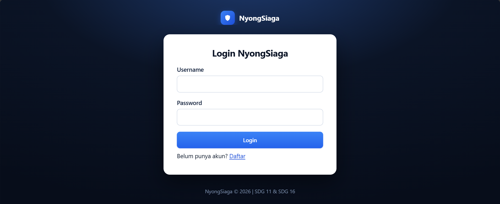
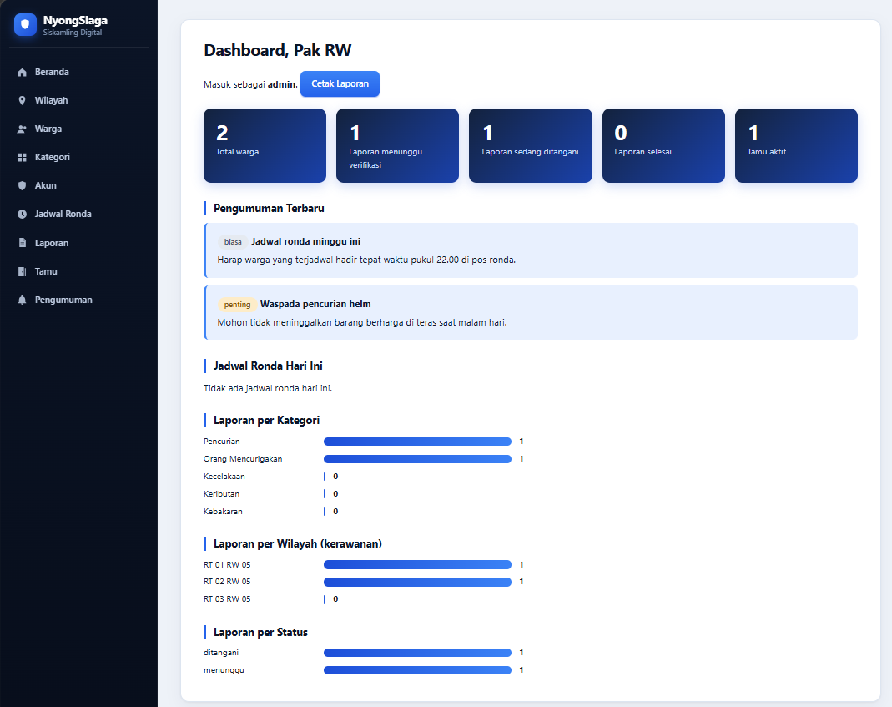
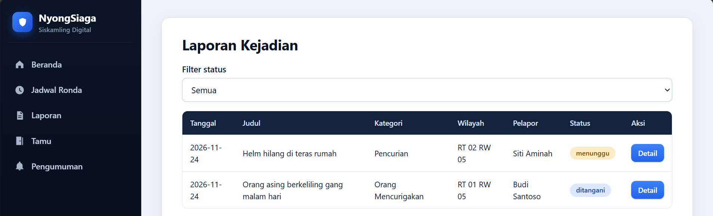
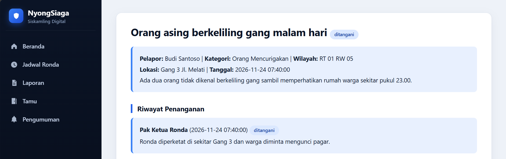
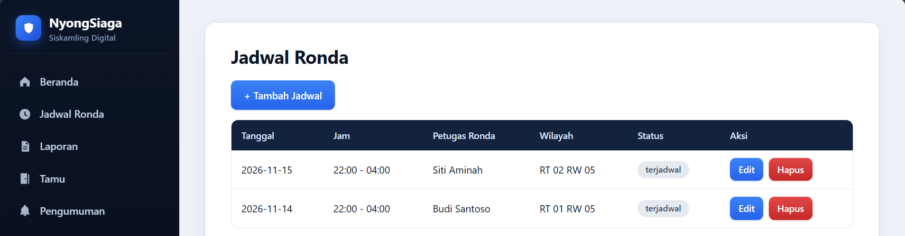
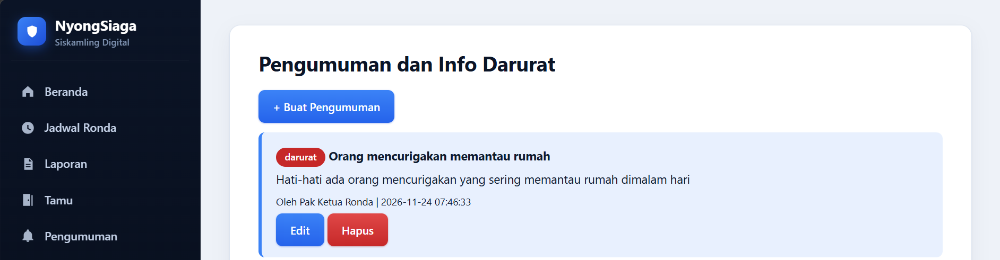
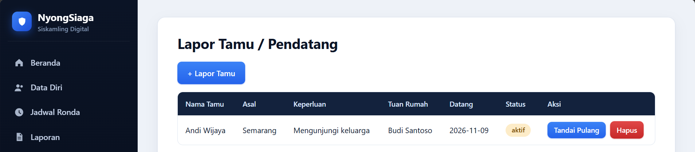
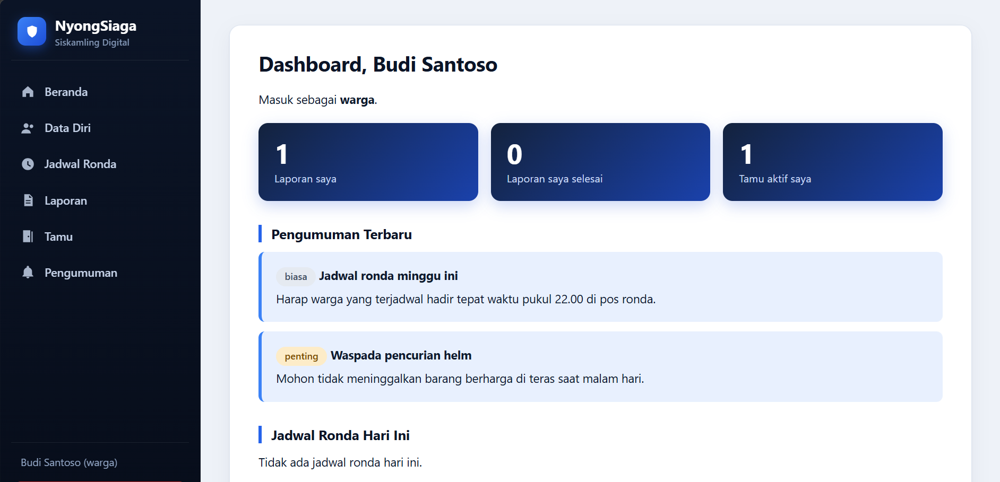

# NyongSiaga - Siskamling Digital

> **Nyong siaga, warga tenang.**

Aplikasi web siskamling digital untuk mengelola jadwal ronda, laporan kejadian, data tamu, dan pengumuman darurat agar lingkungan warga lebih aman dan penanganannya transparan.

Proyek akhir (Responsi 2) Praktikum Pemrograman Web I, Jurusan Informatika, Fakultas Teknik, Universitas Jenderal Soedirman. Kelompok 4, Shift C.



## Daftar Isi

1. [Nama dan Deskripsi Proyek](#1-nama-dan-deskripsi-proyek)
2. [Latar Belakang dan Tujuan](#2-latar-belakang-dan-tujuan)
3. [Daftar Fitur / Modul](#3-daftar-fitur--modul)
4. [Teknologi yang Digunakan](#4-teknologi-yang-digunakan)
5. [Panduan Instalasi dan Konfigurasi](#5-panduan-instalasi-dan-konfigurasi)
6. [Panduan Menjalankan Aplikasi](#6-panduan-menjalankan-aplikasi)
7. [Hak Akses per Role](#7-hak-akses-per-role)
8. [Struktur Database](#8-struktur-database)
9. [Struktur Folder](#9-struktur-folder)
10. [Screenshot](#10-screenshot)
11. [Pemecahan Masalah](#11-pemecahan-masalah)
12. [Anggota Tim](#12-anggota-tim)

## 1. Nama dan Deskripsi Proyek

**NyongSiaga** (konsep Siskamling Digital) adalah aplikasi web berbasis PHP dan MySQL untuk membantu pengurus RW, ketua ronda, dan warga mengelola keamanan lingkungan secara terpadu.

- **Warga** melengkapi data diri, melaporkan kejadian dan tamu, serta memantau status laporannya sendiri.
- **Ketua ronda** menyusun jadwal ronda, memverifikasi atau menolak laporan, mencatat tindak lanjut sampai selesai, dan menyebarkan pengumuman.
- **Pengurus RW (admin)** menyiapkan data master (wilayah, kategori, akun, data warga) dan memantau kondisi lingkungan lewat dashboard rekap.

## 2. Latar Belakang dan Tujuan

**Latar belakang.** Pengelolaan keamanan lingkungan di banyak permukiman masih manual: jadwal ronda ditulis di kertas atau grup chat, laporan kejadian disampaikan lewat obrolan yang mudah tenggelam dan tidak punya status, serta data tamu atau pendatang jarang tercatat. Akibatnya penanganan lambat, tidak ada riwayat, dan warga tidak tahu laporannya sudah ditindaklanjuti atau belum.

**Tujuan.**

1. Menata jadwal ronda secara digital.
2. Memastikan setiap laporan kejadian punya alur dan status yang jelas dari menunggu sampai selesai.
3. Mencatat tamu atau pendatang.
4. Menyebarkan informasi darurat dengan cepat.

**Manfaat.** Warga mudah melapor dan memantau status laporan, ketua ronda punya alur kerja yang jelas dari verifikasi sampai selesai, dan pengurus RW mendapat rekap kerawanan lewat dashboard.

**Keterkaitan dengan SDGs.**

- **SDG 11 (Sustainable Cities and Communities):** permukiman yang aman dan tangguh lewat jadwal ronda yang tertata, laporan kejadian, lapor tamu, dan rekap kerawanan per wilayah.
- **SDG 16 (Peace, Justice and Strong Institutions):** mengurangi kriminalitas dan keributan, serta membangun institusi lokal yang responsif dan transparan lewat status laporan yang bisa dipantau warga dan pengumuman darurat yang cepat.

## 3. Daftar Fitur / Modul

Aplikasi terdiri atas 9 modul yang saling terintegrasi.

| No | Modul | Fitur |
|----|-------|-------|
| 1 | Autentikasi dan akun | Register warga, login, logout, session, hak akses per role (admin, ketua_ronda, warga), admin mengelola akun dan role (CRUD), password disimpan dengan hash |
| 2 | Data warga | Admin mengelola data warga (CRUD), warga melengkapi dan mengubah data dirinya sendiri lewat menu Data Diri |
| 3 | Wilayah dan kategori | CRUD wilayah (RT/RW/blok) dan CRUD kategori kejadian, penghapusan data yang masih dipakai ditolak dengan pesan |
| 4 | Jadwal ronda | CRUD jadwal (petugas, wilayah, tanggal, jam, status terjadwal / hadir / tidak hadir), jadwal boleh melewati tengah malam, warga hanya melihat |
| 5 | Laporan kejadian | Warga membuat laporan (kategori, wilayah, judul, lokasi, deskripsi dengan penghitung karakter maksimal 1000), daftar laporan, filter status untuk admin dan ketua |
| 6 | Verifikasi dan tindak lanjut | Verifikasi atau tolak laporan, catatan tindak lanjut dengan riwayat, alur status dijaga di server: menunggu, diverifikasi atau ditolak, ditangani, selesai |
| 7 | Lapor tamu | Warga melaporkan tamu atau pendatang (nama, asal, keperluan, tanggal datang), tandai pulang, tamu aktif tampil paling atas |
| 8 | Pengumuman | Pengumuman tingkat biasa, penting, dan darurat (CRUD oleh admin dan ketua), pengumuman darurat selalu di posisi teratas |
| 9 | Dashboard dan rekap | Kartu ringkasan, pengumuman terbaru, jadwal ronda hari ini, rekap laporan per kategori / wilayah / status, cetak laporan |

**Validasi dan keamanan**

- Validasi di JavaScript dan diulang di sisi server: nomor HP 8 sampai 15 digit angka, nama tamu hanya huruf, spasi, titik, apostrof, atau strip.
- Validasi lain di server: password minimal 6 karakter, konfirmasi password harus sama, username unik, jam mulai dan jam selesai jadwal tidak boleh sama, judul maksimal 150 karakter, deskripsi dan isi pengumuman maksimal 1000 karakter.
- Query memakai prepared statement, password memakai `password_hash` dan `password_verify`, session id diganti setelah login, keluaran di-escape dengan `htmlspecialchars`.
- Hak akses diperiksa di server pada setiap halaman, bukan hanya disembunyikan di menu. Warga hanya dapat membuka laporan miliknya sendiri, dan admin tidak dapat menghapus akunnya sendiri.

## 4. Teknologi yang Digunakan

- PHP native (mysqli, prepared statement, session), disarankan PHP 8.1 atau lebih baru
- MySQL / MariaDB
- HTML, CSS (satu file eksternal `assets/style.css`), JavaScript (validasi form dan penghitung karakter)
- XAMPP (Apache dan MySQL), Visual Studio Code
- Git dan GitHub

## 5. Panduan Instalasi dan Konfigurasi

1. Pasang **XAMPP** (https://www.apachefriends.org), disarankan versi dengan PHP 8.1 atau lebih baru.
2. Clone repository ini ke folder `htdocs`, hasilnya `C:\xampp\htdocs\siskamling`:
   ```
   git clone https://github.com/IrsyadPSM/Responsi-Pemweb1-Kelompok4-ShiftC.git siskamling
   ```
   Nama folder harus `siskamling`. Jika ingin nama lain, ubah `BASE_URL` di `config/koneksi.php`.
3. Jalankan **Apache** dan **MySQL** di XAMPP Control Panel.
4. Buka phpMyAdmin (`http://localhost/phpmyadmin`), pilih tab **SQL**, lalu tempel dan jalankan isi file `siskamling_digital.sql`. Database `siskamling_digital` beserta data contoh akan dibuat.
5. Jika MySQL memakai password atau port berbeda, ubah di `config/koneksi.php`:
   ```php
   $koneksi = mysqli_connect("localhost", "root", "", "siskamling_digital");
   ```

**Mengulang dari data awal.** File SQL tidak menimpa tabel yang sudah ada. Untuk mereset data, jalankan dulu `DROP DATABASE IF EXISTS siskamling_digital;` di tab SQL, lalu jalankan ulang isi `siskamling_digital.sql`.

**PHP di bawah 8.1.** Agar pesan "data tidak bisa dihapus karena masih dipakai data lain" muncul (bukan error), tambahkan baris berikut di `config/koneksi.php` setelah `mysqli_connect`:
```php
mysqli_report(MYSQLI_REPORT_ERROR | MYSQLI_REPORT_STRICT);
```

## 6. Panduan Menjalankan Aplikasi

Buka `http://localhost/siskamling/login.php`. Mengakses halaman lain tanpa login akan dialihkan ke halaman login.

**Akun contoh** (semua password: `password`)

| Role | Nama | Username | Keterangan |
|------|------|----------|------------|
| Admin (pengurus RW) | Pak RW | `admin` | Akses ke seluruh menu |
| Ketua ronda | Pak Ketua Ronda | `ketua` | Jadwal, laporan, tamu, pengumuman |
| Warga | Budi Santoso | `budi` | Data warga RT 01 RW 05 |
| Warga | Siti Aminah | `siti` | Data warga RT 02 RW 05 |

Warga baru dapat mendaftar lewat tombol **Daftar** di halaman login. Akun hasil pendaftaran otomatis berperan sebagai warga, dan harus melengkapi **Data Diri** dulu sebelum bisa membuat laporan atau melapor tamu.

**Data contoh** yang ikut terimpor: 3 wilayah (RT 01, RT 02, RT 03 RW 05), 5 kategori kejadian (Pencurian, Orang Mencurigakan, Kecelakaan, Kebakaran, Keributan), 2 jadwal ronda, 2 laporan, 1 tindak lanjut, 1 tamu, dan 2 pengumuman.

**Alur penggunaan singkat**

1. **Warga** login, melengkapi data diri bila belum, lalu membuat laporan lewat menu Laporan. Status awal laporan adalah `menunggu`.
2. **Ketua ronda** (atau admin) membuka detail laporan, lalu memilih **Verifikasi** atau **Tolak**.
3. Untuk laporan `diverifikasi`, ketua menambah tindak lanjut dengan status `ditangani`, lalu `selesai`. Setiap catatan tersimpan sebagai riwayat.
4. **Warga** memantau status dan riwayat penanganan laporannya di menu Laporan.
5. **Admin** memantau rekap per kategori, wilayah, dan status di dashboard, lalu dapat mencetak laporan lewat tombol **Cetak Laporan**.

Alur status laporan:

```
menunggu -> diverifikasi -> ditangani -> selesai
        \-> ditolak
```

## 7. Hak Akses per Role

| Fitur | Admin | Ketua ronda | Warga |
|-------|:-----:|:-----------:|:-----:|
| Dashboard rekap lengkap dan cetak laporan | Ya | Ya | Tidak (kartu milik sendiri) |
| Wilayah, kategori, data warga, akun | Kelola | Tidak | Tidak |
| Data Diri | Tidak | Tidak | Kelola milik sendiri |
| Jadwal ronda | Kelola | Kelola | Lihat |
| Membuat laporan kejadian | Tidak | Tidak | Ya |
| Melihat laporan | Semua | Semua | Milik sendiri |
| Verifikasi, tolak, dan tindak lanjut laporan | Ya | Ya | Tidak |
| Tamu | Lihat semua, tandai pulang, hapus | Lihat semua (hanya memantau) | Lapor, tandai pulang, hapus milik sendiri |
| Pengumuman | Kelola | Kelola | Baca |

## 8. Struktur Database

Database `siskamling_digital` terdiri atas 9 tabel.

| Tabel | Fungsi |
|-------|--------|
| `users` | Akun login dan role (`admin`, `ketua_ronda`, `warga`) |
| `wilayah` | Data RT/RW/blok |
| `warga` | Data warga (alamat, nomor HP) yang terhubung ke `users` dan `wilayah` |
| `jadwal_ronda` | Jadwal ronda per petugas, wilayah, tanggal, dan jam |
| `kategori_kejadian` | Kategori laporan kejadian |
| `laporan_kejadian` | Laporan warga beserta status alurnya |
| `tindak_lanjut` | Riwayat penanganan laporan oleh petugas |
| `tamu` | Data tamu atau pendatang dan tanggal pulang |
| `pengumuman` | Pengumuman dengan tingkat biasa, penting, atau darurat |

## 9. Struktur Folder

```
siskamling/
├── index.php                  dashboard (menyesuaikan role)
├── login.php, register.php, logout.php
├── siskamling_digital.sql     skema database dan data contoh
├── README.md, README_SETUP.txt
├── assets/                    style.css
├── config/                    koneksi database dan BASE_URL
├── includes/                  auth (session, hak akses), header, footer
├── users/                     kelola akun (admin)
├── warga/                     data warga (admin) dan data diri (warga)
├── wilayah/                   kelola wilayah (admin)
├── kategori/                  kelola kategori kejadian (admin)
├── ronda/                     jadwal ronda
├── laporan/                   laporan, verifikasi, tindak lanjut
├── tamu/                      lapor tamu
└── pengumuman/                pengumuman dan info darurat
```

Setiap modul CRUD memakai pola yang sama: `index.php` (daftar), `form.php` (tambah dan ubah), `hapus.php` (hapus).

## 10. Screenshot

**Dashboard admin**



**Daftar laporan (ketua ronda)**



**Detail laporan dengan riwayat penanganan**



**Jadwal ronda**



**Pengumuman dan info darurat**



**Lapor tamu (warga)**



**Dashboard warga**



## 11. Pemecahan Masalah

| Masalah | Penyebab dan solusi |
|---------|---------------------|
| Halaman tidak ditemukan atau CSS tidak tampil | Nama folder harus `siskamling` di dalam `htdocs`, atau ubah `BASE_URL` di `config/koneksi.php` |
| "Gagal koneksi database" | Pastikan MySQL di XAMPP menyala, database sudah diimpor, serta pengguna dan password di `config/koneksi.php` benar |
| Import SQL gagal karena tabel sudah ada | Jalankan `DROP DATABASE IF EXISTS siskamling_digital;` lalu import ulang |
| Login `ketua` gagal | Username-nya `ketua`, bukan `ketua1`. Password semua akun contoh adalah `password` |
| Menghapus wilayah yang dipakai menghasilkan error | Gunakan PHP 8.1 ke atas, atau tambahkan `mysqli_report(MYSQLI_REPORT_ERROR \| MYSQLI_REPORT_STRICT);` di `config/koneksi.php` |
| Dropdown Akun kosong di menu Warga | Semua akun warga sudah punya data. Tambah akun warga baru lewat menu Akun |
| Warga dialihkan ke halaman Data Diri | Data diri belum dilengkapi. Isi dulu agar bisa memakai menu Laporan dan Tamu |

## 12. Anggota Tim

| Nama | NIM | Peran |
|------|-----|-------|
| Irsyad Palupi Sidqi Musdiarto | H1D025028 | Koordinator, autentikasi, data warga, wilayah, kategori |
| Muhammad Rasya Putra Ramadhan | H1D025003 | Jadwal ronda, laporan kejadian, verifikasi dan tindak lanjut |
| Muhammad Rafly Abimanyu | H1D025010 | Lapor tamu, pengumuman, dashboard |
